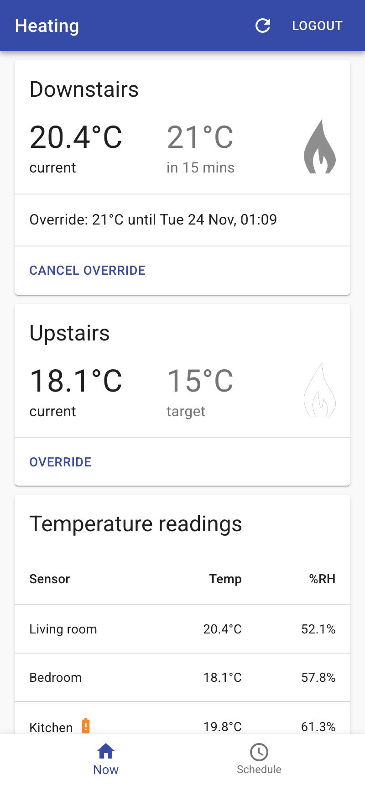

# The BoilerIO Software Thermostat

BoilerIO is an open-source software thermostat that replaces old, clunky, RF
thermostats and gives you a modern, connected experience on older hardware.

  

Key features are:
- Support for Danfoss RX1 or RX2 RF receivers – these are typically used with
  the TPx000 series wireless room thermostats. Contributions welcome to add
  support for other receivers.
- [Web UI](https://github.com/adpeace/boilerio-ui), [Alexa
  skill](https://github.com/adpeace/boilerio-alexa), and [Home
  Assistant](https://github.com/adpeace/boilerio-home-assistant) plugins give you
  a choice of ways to interact with your heating.
- A modern RESTful API with token-based and Google Sign-In authentication for
  programmatic access and support for multilple users.
- Keeps running your heating even when the Internet is down by caching the
  schedule and any overrides locally. You can also install the backend on your
  local network if you prefer.
- Modern PID-based control algorithm, rather than on/off control with
  hysteresis, keeps the temperature more constant. BoilerIO learns the
  parameters needed to maintain the temperature.

BoilerIO has been running my own heating since 2017 with very few issues. It has
extended the life of my Danfoss hardware that would otherwise have been replaced
years ago. It's also helped me reduce my gas usage and carbon footprint by
allowing me to turn off the heating when away longer than expected, or turn it
back on just in time.

For more information, please see [my blog](https://andyhacks.com). These posts
tell the story of how BoilerIO was built:

1. [Danfoss Wireless Thermostat Hacking – Part One](https://andyhacks.com/2017/01/14/danfoss-wireless-thermostat-hacking-part-one/) (January 2017)
2. [Danfoss Wireless Thermostat Hacking – Part Two](https://andyhacks.com/2017/02/07/danfoss-wireless-thermostat-hacking-part-two/) (February 2017)
3. [Boiler Control to Maintain a Set Temperature](https://andyhacks.com/2017/04/07/boiler-control-to-maintain-a-set-temperature/) (April 2017)
4. [The BoilerIO Software Thermostat](https://andyhacks.com/2017/06/11/the-boilerio-software-thermostat/) (June 2017)
5. [Controlling your heating from anywhere](https://andyhacks.com/2017/09/10/controlling-your-heating-from-anywhere/) (September 2017)
6. [Heating season 2019 is here!](https://andyhacks.com/2019/12/27/heating-season-2019-is-here/) (December 2019)

The older posts describe the software as it was then; for current setup
instructions, see the [setup guide](docs/SETUP.md).

## Hardware required for setup

> [!WARNING]
> No warranty is provided: please be careful if you are messing with your own
> heating system.

- A local computer such as a Raspberry Pi.
- A [JeeLink](https://www.digitalsmarties.net/products/jeelink) 433MHz version
  with the [thermostat/RF control
  software](https://github.com/adpeace/thermostat.git) on it. The setup guide
  will explain how to install this from a factory JeeLink, or you can use other
  Arduino-compatible hardware and RF69 module.
- A Danfoss RF receiver such as the RX1/RX2, or alternative if you're bringing
  your own software.
- At least one temperature sensor per zone you wish to control. This project
  uses [emonTH](https://docs.openenergymonitor.org/emonth2/install.html)
  sensors with emonhub, however you could use other sensors if you write bridge
  code to publish the readings to MQTT in the expected format.

## Documentation

- [Getting Started/Setup](docs/SETUP.md) covers setting up the service for your own home from scratch, including detailed hardware requirements.
- [Release process](docs/RELEASE.md) describes the steps involved in doing a release (targeted at maintainers).

## Contributions

Contributions are welcomed of code, issues and bug reports, documentation
improvements, security fixes, etc. AI-assisted code is accepted provided it has
been reviewed by a human before submission, that human is the submitter, and
they can understand, answer questions about, and certify to the best of their
knowledge the quality of the submission.